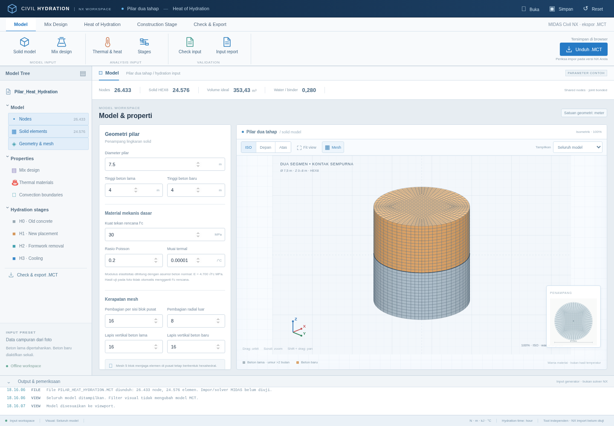
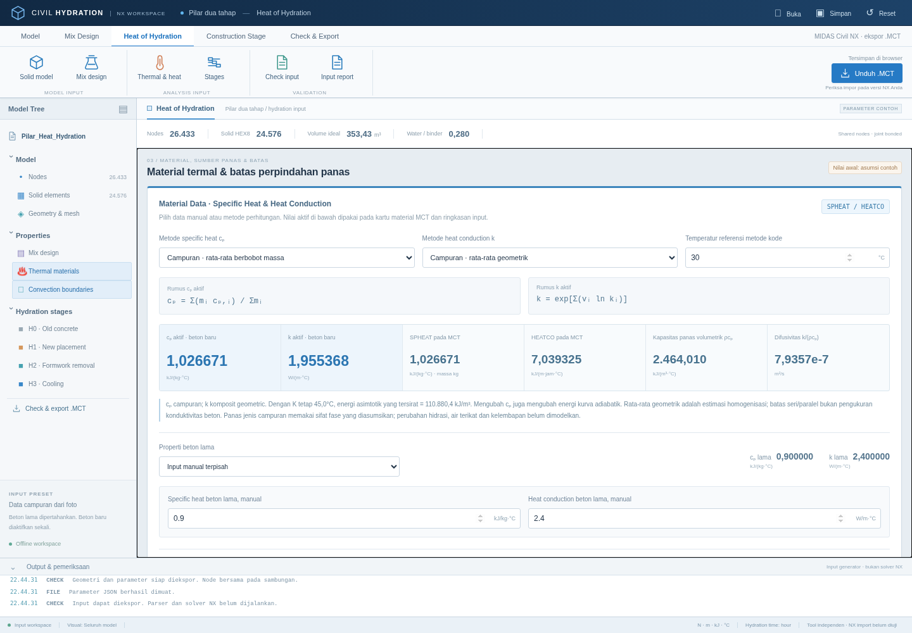

# MIDAS Civil Parametric — Pilar Solid FC30

## Aplikasi Windows (.exe)

**[Unduh installer Windows 64-bit v1.1.1 — panduan konveksi (.exe)](https://github.com/azzumarutami95-oss/MIDAS-CIVIL-PARAMETRIC/releases/download/v1.1.1-convection/Civil-Hydration-NX-Setup-1.1.1-x64.exe)**

**[Unduh installer Civil Hydration NX dari GitHub Releases](https://github.com/azzumarutami95-oss/MIDAS-CIVIL-PARAMETRIC/releases/latest)**

Pilih `Civil-Hydration-NX-Setup-1.1.1-x64.exe` untuk Windows 10/11 64-bit (x64).
Aplikasi menyertakan runtime dan dapat dipakai offline untuk mengatur material
termal, mix design, mesh, staging, serta mengekspor `.MCT`, parameter JSON dan
ringkasan input. **Save (Ctrl+S)** memperbarui proyek JSON aktif; **Save As
(Ctrl+Shift+S)** menyimpan dengan nama/lokasi baru. Nama file dan tanda perubahan
ditampilkan, dengan pengingat saat menutup atau membuka proyek lain. Installer
belum ditandatangani secara digital.

[Petunjuk instalasi, pemindahan parameter HTML, dan build Windows](desktop/README.md).

Rilis v1.1.1 menambahkan **SW · Dead Load (D) · LG_SW** dengan faktor global
default **(0, 0, −1)** pada aplikasi, JSON, pratinjau, laporan TXT, dan ekspor
MCT. Grup beban diaktifkan mulai H0; JSON v1 lama dimigrasikan otomatis.
[Rincian parameter dan aktivasi SW](web/README.md#berat-sendiri-sw).

Pembaruan material pada versi aplikasi **1.1.1** menambahkan **Creep &
Shrinkage**, **Compression Strength**, dan **Time Dependent Material Link**.
Pilihan kode ACI, CEB-FIP 1990, AASHTO serta tabel user/custom jobmix ikut
tersimpan pada JSON, pratinjau, laporan, dan MCT. AASHTO untuk perkembangan
kuat tekan menggunakan konvensi ACI 209R-92 yang dijelaskan WSDOT.
[Metode, parameter, satuan, dan cakupan ekspor](web/TIME_DEPENDENT_METHODS.md).
Versi aplikasi tetap 1.1.1. Revisi terbaru `v1.1.1-convection` menambahkan
**kriteria rentang dan petunjuk convection boundaries**, dengan acuan udara,
bekisting/curing, satuan, asumsi dan cara memilih nilai.
[Panduan konveksi dan rujukan](web/CONVECTION_GUIDE.md).

**[Unduh contoh MCT dengan C&S, kekuatan dan link](https://github.com/azzumarutami95-oss/MIDAS-CIVIL-PARAMETRIC/releases/download/v1.1.1-convection/PILAR_TIME_DEPENDENT_EXAMPLE.MCT)**
dan [JSON yang dapat dibuka di aplikasi](https://github.com/azzumarutami95-oss/MIDAS-CIVIL-PARAMETRIC/releases/download/v1.1.1-convection/PARAMETER_TIME_DEPENDENT_EXAMPLE.json).
Contoh CEB-FIP 1990 menghubungkan beton baru saja; parameter merupakan asumsi
yang perlu disesuaikan dan bukan jobmix terkalibrasi.

## Aplikasi HTML untuk menyusun input hidrasi

**[Unduh CIVIL_HEAT_HYDRATION_NX.html](https://github.com/azzumarutami95-oss/MIDAS-CIVIL-PARAMETRIC/raw/refs/heads/main/downloads/CIVIL_HEAT_HYDRATION_NX.html)**

Tampilan baru bergaya ruang kerja NX: ribbon, model tree, panel properti,
viewport interaktif dengan orbit/zoom/pan, tampak ISO/depan/atas, filter segmen
dan panel output. Ekspor tetap **MCT** untuk diimpor ke Civil NX. Aplikasi ini
bukan MIDAS Civil NX dan tidak menghasilkan berkas native `.mcb` langsung.

Buka file HTML di browser. Edit campuran dari foto, geometri, mesh, sifat
termal, konveksi, sumber panas dan empat tahap, lalu klik **Unduh .MCT**.
Tidak perlu instalasi atau koneksi internet. Tersedia pratinjau mesh/kurva,
koreksi batch, konversi satuan, simpan/buka JSON dan ringkasan input.

Pada tab **Time Dependent Material**, pilih model C&S dan kuat tekan,
periksa parameter curing/kelembapan/ukuran, isi tabel custom bila diperlukan,
dan tentukan link ke material beton lama/baru. Proyek baru menghubungkan
beton baru; JSON lama membuka fitur ini dalam keadaan nonaktif agar perilaku
material mekanis sebelumnya tetap dipertahankan.

**Material Data**: specific heat dan heat conduction dapat diinput manual atau
dihitung dari sifat fase campuran; tersedia pula acuan EN1992-1-2 pada suhu
referensi. Beton lama dapat memakai cp/k terpisah. Nilai aktif langsung masuk
ke SPHEAT/HEATCO MCT. [Rumus dan rujukan metode](web/THERMAL_METHODS.md).

Contoh JSON untuk tombol **Buka**: [campuran + beton lama manual](examples/THERMAL_MIXTURE.json)
dan [acuan EC2 pada Tref](examples/THERMAL_EC2_REFERENCE.json).

[Petunjuk aplikasi dan batas penggunaan](web/README.md). Angka termal adalah
asumsi contoh; impor/solver MIDAS dan penilaian retak belum tervalidasi.

## Model contoh panas hidrasi bertahap

**[Unduh MCT hidrasi + staging](https://github.com/azzumarutami95-oss/MIDAS-CIVIL-PARAMETRIC/raw/refs/heads/main/output/pilar_fc30_hydration/PILAR_FC30_HYDRATION_STAGED_ASSUMED.mct)**

[Unduh paket ZIP hidrasi](https://github.com/azzumarutami95-oss/MIDAS-CIVIL-PARAMETRIC/raw/refs/heads/main/output/PILAR_FC30_HYDRATION_PAKET.zip)

- [Parameter, tahap, kondisi batas dan petunjuk analisis](output/pilar_fc30_hydration/README_HYDRATION.md)
- [Parameter contoh yang dapat diubah](output/pilar_fc30_hydration/parameters.json)
- [Sumber teknis dan batas verifikasi jurnal](output/pilar_fc30_hydration/SOURCES.md)

Model hidrasi menggunakan **N–m–kJ–°C, waktu jam** dan empat tahap sampai 30 hari
setelah pengecoran baru. Mencakup sumber panas adiabatik, konveksi bekisting/
udara/curing, suhu awal/dasar, dan pergantian grup batas. Nilai input merupakan
**asumsi contoh**, bukan hasil kalibrasi campuran/proyek. Pola tahap dicocokkan
dengan tutorial resmi MIDASIT; impor/solver native dan verifikasi jurnal belum
dilaksanakan. Belum merupakan penilaian retak yang tervalidasi.

## Model geometri awal

Model dasar solid HEX8 untuk MIDAS Civil klasik: pilar diameter 7,5 m,
tinggi 8 m, terdiri dari beton lama 4 m dan beton baru 4 m.

**[Unduh file MCT](https://github.com/azzumarutami95-oss/MIDAS-CIVIL-PARAMETRIC/raw/refs/heads/main/output/pilar_fc30/PILAR_D7500_H8000_FC30_HEX8.mct)**

- [Lihat file MCT di GitHub](output/pilar_fc30/PILAR_D7500_H8000_FC30_HEX8.mct)
- [Petunjuk impor dan asumsi material](output/pilar_fc30/PETUNJUK_IMPORT.md)

Model berisi 26.433 node dan 24.576 elemen solid 8-node. Material elastis
berbasis f'c 30 MPa menggunakan asumsi E = 25,74 GPa. Pemeriksaan geometri
lolos; impor langsung di MIDAS Civil belum diuji.

**Belum merupakan model analisis panas hidrasi lengkap.** Properti termal,
pembangkitan panas, suhu awal, kondisi curing, dan tahap analisis belum
ditetapkan. Baca petunjuk sebelum menjalankan analisis.
